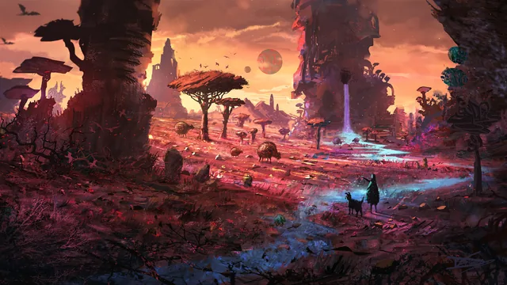

<p align="center">
  
</p>

<h1 align="center">Mandara OS</h1>

<p align="center">
  <b>A hyper-optimized, bloat-free Linux desktop, built around Mandara Shell.</b>
  <br/>
  Fedora as a bootable image, the CachyOS kernel, MangoWM and nothing you didn't ask for.
  <br/>
  Rebuilt by itself every time Mandara ships, for x86_64 and aarch64.
</p>

<p align="center">
  <a href="https://github.com/theHamdiz/mandara-os/releases/latest">
    
  </a>
</p>

<p align="center">
  <a href="https://github.com/theHamdiz/mandara-os/stargazers"></a>
  <a href="https://github.com/theHamdiz/mandara-os/releases/latest"></a>
  <a href="https://github.com/theHamdiz/mandara-os/commits/main"></a>
  <a href="https://discord.gg/kPBaS2reQ3"></a>
  <a href="#license"></a>
  <a href="https://ko-fi.com/thehamdiz"></a>
</p>

<p align="center">
  <a href="https://github.com/theHamdiz/mandara"></a>
  <a href="#at-a-glance"></a>
  <a href="#what-sets-it-apart"></a>
  <a href="#what-sets-it-apart"></a>
  <br/>
  <a href="#download"></a>
  <a href="#download"></a>
  <a href="#what-sets-it-apart"></a>
</p>

<p align="center">
  <a href="#download"><b>Download</b></a> ·
  <a href="#install">Install</a> ·
  <a href="#living-with-it">Living with it</a> ·
  <a href="#common-questions">Questions</a> ·
  <a href="#how-its-built">How it's built</a> ·
  <a href="AGENTS.md">Contributing</a> ·
  <a href="https://github.com/theHamdiz/mandara"><b>Mandara Shell</b></a>
</p>

---

**Mandara OS** is a Linux distribution: a hyper-optimized, bloat-free,
image-based Fedora desktop for software development and everyday personal
use, for x86_64 and aarch64. It starts from a clean Fedora base, swaps in a
low-latency kernel and scheduler, compiles its compositor for a modern CPU
baseline (x86-64-v3, or ARMv8 with crypto and CRC), and
puts [Mandara Shell](https://github.com/theHamdiz/mandara) on
[MangoWM](https://github.com/mangowm/mango) as the desktop. Everything else
is left out: no second desktop hiding underneath, no pile of preinstalled
apps, no background services idling away your memory.

It ships as a **bootable container image** ([bootc](https://bootc-dev.github.io/bootc/)).
Your system is one versioned image: an update is downloaded whole, applied at
the next boot, and one command takes you back if you don't like it. Your
home folder, `/var`, `/opt` and `/usr/local` stay yours and writable.

And it's never stale. The moment a new Mandara release is published, its own
release pipeline asks this repository to build a fresh image around it, for
both architectures, with new downloads attached. Installed systems pick it
up with `sudo bootc upgrade`.

## At a glance

| | |
|---|---|
| **What** | A bootable Fedora desktop image: Mandara Shell on MangoWM, with its own login screen, lock screen and boot splash |
| **Base** | Fedora 45 via [Universal Blue](https://universal-blue.org) `base-main` on x86_64 (codecs, firmware, ujust), Fedora `fedora-bootc` on aarch64 |
| **Kernel** | CachyOS with LTO, the `scx_lavd` scheduler in performance mode and KSM on x86_64; Fedora's kernel on aarch64 |
| **Apps** | Ghostty, Helium and Files. That's the list |
| **Developers** | git, gh, clang/lld/lldb, gcc, cmake, meson, Podman, Docker Engine, and Rust ready offline through rustup |
| **Terminal** | 22 Rust command-line tools, starship, fish and bash, all wired up |
| **Downloads** | Installer ISO, plus ready-to-boot qcow2, vmdk and raw disks, for x86_64 and aarch64 |
| **Updates** | `sudo bootc upgrade` for the system; Studio → About → **Update now** for Mandara, without root |
| **License** | GPL-3.0-or-later |

## More than a shell on a distro

You can install [Mandara Shell](https://github.com/theHamdiz/mandara) on
almost any Linux distribution, and that gives you the Mandara desktop.
Mandara OS is the whole machine around it, tuned as one piece:

| Layer | Mandara Shell on your distribution | Mandara OS |
|---|---|---|
| **Desktop** | Mandara on your compositor | Mandara on MangoWM, with Mandara Login, the lock screen and the boot splash |
| **Kernel** | Your distribution's | CachyOS LTO with `scx_lavd` and KSM (x86_64) |
| **System tuning** | Your distribution's | Low-latency kernel arguments, BBR, Btrfs with zstd, masked idle services |
| **Compositor** | Your distribution's package | MangoWM and scenefx compiled with ThinLTO for x86-64-v3, or ARMv8 with crypto and CRC |
| **Developer tools** | Whatever you install | C/C++, Rust, Podman, Docker and 22 Rust command-line tools, ready |
| **Updates** | Your package manager | Atomic image updates with one-command rollback |

## What sets it apart

1. **Built around one shell, all the way down.** Mandara isn't added to a
   desktop that already has one. The login screen is Mandara Login, the
   session is MangoWM with Mandara on top, the boot splash is the Mandara
   phoenix on Corniche blue, and the default theme is Mandara Corniche.

2. **A kernel tuned for latency.** On x86_64 the CachyOS kernel (built with
   LTO) replaces Fedora's, with sched-ext's `scx_lavd` scheduler in
   performance mode, full preemption, threaded interrupts, BBR congestion
   control and no watchdogs. Same-page merging (KSM) shares identical memory
   between login sessions.

3. **Compiled for a modern CPU baseline.** MangoWM and its scenefx effects
   library are built from source with clang at `-O3` and ThinLTO, for a fixed
   target: x86-64-v3 on x86_64 (so an AVX2-era processor is required) and
   ARMv8 with the crypto and CRC extensions on aarch64. Mandara itself
   is its x86-64-v3 release build, checked against the release's checksums.

4. **Zero bloat, by rule.** Every package is installed without weak
   dependencies, printing, modem and mDNS services are masked, and each
   virtual-machine agent only starts on its own hypervisor. Docker Engine
   stays off until you ask for it.

5. **A developer machine out of the box.** A full C/C++ and Rust toolchain,
   Podman with its Docker-compatible socket, Docker Engine one command away,
   and a stable Rust toolchain (clippy, rustfmt, rust-analyzer) that's copied
   into your home on first use: it works offline right away, and `rustup`
   can update it or add nightly like anywhere else.

6. **The best of Rust in the terminal.** ripgrep, bat, fd, starship, helix,
   delta, zoxide, hyperfine, yazi, zellij, atuin, just, gitui, eza, tokei,
   bottom, bandwhich, dust, procs, sd, xh and cargo-nextest, with starship,
   zoxide and atuin already set up in bash and fish, and delta as git's
   pager.

7. **Latin and Arabic as equals.** Inter, Alexandria, Cairo and JetBrains
   Mono are the system fonts, Noto covers every other language Mandara is
   translated into, and colour emoji just work.

8. **Btrfs with compression.** The ready-made disks use Btrfs, and zstd:1
   compression is switched on at every boot.

9. **Mandara updates itself, safely.** Mandara runs from a writable copy of
   the image's binary, so its own **Update now** works without root. If an
   update fails to start, the image's version takes over again by itself.

10. **Never behind.** Each Mandara release triggers a new image, signed and
    published for both architectures, with fresh downloads.

## Six wallpapers

New accounts start on the forest river and rotate through all six. They're
in the wallpaper picker and on the login screen too.

<p align="center">
  
  
  
  
  
  
</p>

## Download

Each [release](https://github.com/theHamdiz/mandara-os/releases) is named
after the Mandara version it's built around and carries these files for
`x86_64` and `aarch64`:

| File | Use it for |
|---|---|
| `mandara-os-<version>-<arch>.iso` | A USB stick, or an installer in any virtual machine |
| `mandara-os-<version>-<arch>.qcow2.zst` | GNOME Boxes, virt-manager, QEMU/KVM, Proxmox |
| `mandara-os-<version>-<arch>.vmdk.zst` | VirtualBox, VMware |
| `mandara-os-<version>-<arch>.raw.zst` | Parallels, UTM, or writing straight to a disk |
| `SHA256SUMS-<arch>` | Checksums for all of the above |

Files over 2 GiB come in numbered parts (`.part00`, `.part01`, …). For the
file you want, join its parts if it has any, check it, and unpack it if it's
a disk:

```bash
f=mandara-os-<version>-x86_64.qcow2.zst                               # the file you want
[ -e "$f" ] || { cat "$f".part* > "$f.tmp" && mv "$f.tmp" "$f"; }     # only when it came in parts
grep "  $f\$" SHA256SUMS-x86_64 | sha256sum -c - &&                   # stops if it's missing or wrong
  zstd -d "$f"                                                        # disks only, not the ISO
```

## Install

**From a USB stick.** Write the ISO with Fedora Media Writer, or
`sudo dd if=mandara-os-<version>-<arch>.iso of=/dev/sdX bs=4M status=progress oflag=sync`
(check `sdX` with `lsblk` first: it is erased). Boot it, pick a disk and
create your account. The ISO carries the whole system, so it installs
offline.

**In a virtual machine.** Import the qcow2, vmdk or raw disk and boot it.
Sign in as **mandara** with the password **mandara**; the first login asks
you for a new one. Or boot the ISO and install as above.

**From another bootc system** (Fedora Atomic, Universal Blue):

```bash
sudo bootc switch ghcr.io/thehamdiz/mandara-os:latest
```

### Before you install

- **x86_64 needs an x86-64-v3 processor** (AVX2: Intel Haswell, AMD Zen or
  newer). In a virtual machine, pass the host CPU through.
- **Turn Secure Boot off on x86_64.** The CachyOS kernel isn't signed with a
  key your firmware trusts.
- The bootloader is GRUB, which is what bootc installs on Fedora. Its menu
  lists the previous image too, so you can boot back into it.

## Living with it

| Command | What it does |
|---|---|
| `sudo bootc upgrade` | Fetch the newest image; it's applied at the next boot |
| `sudo bootc rollback` | Boot the previous image again |
| `sudo bootc status` | Which image you're on, and which comes next |
| `ujust mandara-reset-shell` | Go back to the Mandara version that came with the image |
| `ujust mandara-enable-docker` | Turn on Docker Engine (`podman` instead points `docker` at rootless Podman) |
| `ujust mandara-unlock-os` | Make `/usr` writable until the next reboot, for quick experiments |

Mandara updates itself as usual: **Studio → About → Update now**. Shortcuts
to remember: **Super+Return** a terminal, **Super+Space** the launcher,
**Super+E** files, **Super+B** the browser, **Super+L** lock.

## Common questions

**What is Mandara OS?** A Linux distribution: an image-based Fedora
desktop operating system tuned for development and personal use, with the
CachyOS kernel and sched-ext on x86_64, Btrfs and a ready developer toolchain, and Mandara
Shell on MangoWM as its desktop.

**Is it just Mandara Shell installed on Fedora?** No. Mandara OS replaces
the kernel and scheduler, tunes the system, compiles its own compositor,
sets up the login, boot and update chain, and ships a developer toolchain.
[Mandara Shell](https://github.com/theHamdiz/mandara) is the desktop part,
and it also runs on other distributions on its own.

**Who is it for?** Developers who want a fast, quiet, ready-to-work
machine, and anyone who wants Mandara with no setup at all.

**Can I install other apps?** Yes. Flatpak (built in on x86_64),
`cargo install`, AppImages and anything in `/opt` or `/usr/local` work as
usual, and Podman or Docker containers cover the rest. For changes to the system itself, build
your own image on top of this one.

**Where did my changes to `/usr` go?** `/usr` is part of the image, so it's
read-only and replaced on each update. `ujust mandara-unlock-os` makes it
writable until the next reboot.

**Does it work on ARM?** Yes. Every release is built natively for aarch64,
with Fedora's kernel instead of CachyOS's (which is x86_64-only).

**How fresh is it?** As fresh as Mandara: each Mandara release builds a new
image on the newest Fedora packages, MangoWM release and command-line tools.

## How it's built

```
theHamdiz/mandara                      theHamdiz/mandara-os
Release published ─► mandara-os.yml ─► build-os.yml ─────────► build-disks.yml
                     (version)         image for x86_64          ISO, qcow2, vmdk, raw
                                       and aarch64, signed,      attached to the release
                                       ghcr.io/thehamdiz/mandara-os
```

- **Only a Mandara release builds it.** The image workflow has one trigger:
  the `mandara-shell-updated` dispatch Mandara's release pipeline sends with
  the new version. Pull requests here are only linted.
- **[`Containerfile`](Containerfile)**, stage 1, compiles scenefx and
  MangoWM, and fetches the Mandara release, the command-line tools, fonts and
  cursor. Stage 2 is the system:
  [`build_files/build.sh`](build_files/build.sh) plus
  [`system_files/`](system_files), copied over `/`. The build checks every
  binary's libraries, MangoWM's config and `bootc container lint` before it
  finishes.
- **[`build-os.yml`](.github/workflows/build-os.yml)** builds both
  architectures on native runners and publishes `:<version>`, and `:latest`
  when it's the newest release, signed with cosign.
  **[`build-disks.yml`](.github/workflows/build-disks.yml)** turns that exact
  image into the downloads with bootc-image-builder.

Build it yourself (nothing is pushed):

```bash
podman build --platform linux/amd64 --cap-add=SYS_ADMIN \
  --build-arg BASE_IMAGE=ghcr.io/ublue-os/base-main:45 \
  --build-arg MANDARA_VERSION=0.28.0 -t mandara-os .
```

On aarch64, use `--platform linux/arm64` and
`BASE_IMAGE=quay.io/fedora/fedora-bootc:45`.

<details>
<summary><b>Maintainer setup</b></summary>

1. A fine-grained token with **Contents: Read and write** on
   `theHamdiz/mandara-os`, saved as `OS_TRIGGER_PAT` in `theHamdiz/mandara`.
2. A cosign key pair: `COSIGN_PRIVATE_KEY` and `COSIGN_PASSWORD` in this
   repository, with `cosign.pub` committed next to this README. Without them
   images are pushed unsigned, with a warning.
3. The `mandara-os` package on GitHub's container registry set to
   **public**, so `bootc` can pull it without signing in.

</details>

## Learn more

- **[Mandara Shell](https://github.com/theHamdiz/mandara)**: the desktop
  this system is built around, with its
  [website](https://thehamdiz.github.io/mandara/),
  [documentation](https://github.com/theHamdiz/mandara/blob/main/docs/README.md)
  and [install guide](https://github.com/theHamdiz/mandara/blob/main/docs/install.md)
  for other distributions
- **[AGENTS.md](AGENTS.md)**: how the image is built, the rules and how to
  contribute, for people and AI coding agents
- **[llms.txt](llms.txt)**: a summary of Mandara OS for language models
- **[CITATION.cff](CITATION.cff)**: how to cite Mandara OS
- **[MangoWM](https://github.com/mangowm/mango)**,
  **[bootc](https://bootc-dev.github.io/bootc/)** and
  **[Universal Blue](https://universal-blue.org)**: the projects it builds on

## Star history

<p align="center">
  <a href="https://www.star-history.com/#theHamdiz/mandara-os&Date">
    <picture>
      <source media="(prefers-color-scheme: dark)" srcset="https://api.star-history.com/svg?repos=theHamdiz/mandara-os&type=Date&theme=dark"/>
      <source media="(prefers-color-scheme: light)" srcset="https://api.star-history.com/svg?repos=theHamdiz/mandara-os&type=Date"/>
      
    </picture>
  </a>
</p>

## Supporting Mandara

Mandara OS and Mandara Shell are free, open source and always will be. If
they make your computer a little nicer and you'd like to say thanks, you can
chip in toward the build minutes, AI credits and developer time that go into
them:

[](https://ko-fi.com/thehamdiz)

It's entirely optional. Using it, telling a friend or reporting a bug helps
just as much. Thank you!

## License

Mandara OS is free software under the **GNU General Public License, version
3 or later** ([LICENSE](LICENSE)). The packages in the image keep their own
licenses, and Mandara Shell is GPL-3.0-or-later too. Alexandria and Cairo
are under the SIL Open Font License. The six bundled wallpapers belong to
their artists.
